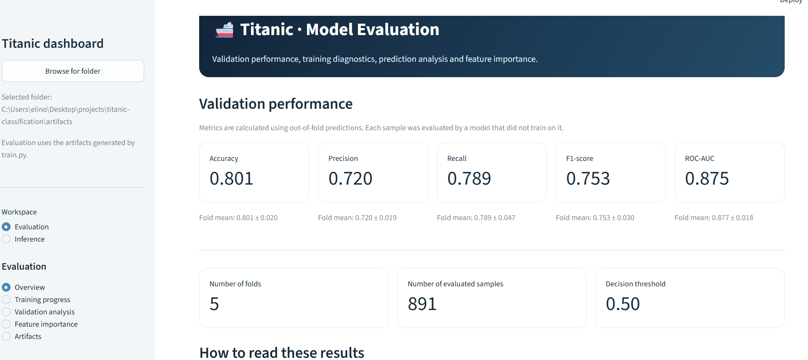
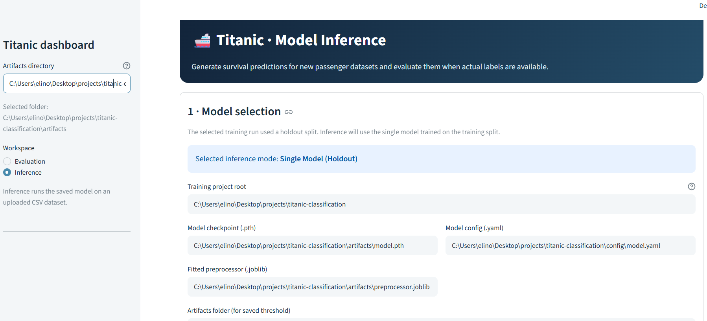

<!-- omit from toc -->
# Titanic Classification
based on  **[Titanic dataset from Kaggle](https://www.kaggle.com/competitions/titanic/data)**.
<!-- omit from toc -->
## Table of Contents

- [Project Structure](#project-structure)
- [Installation](#installation)
  - [1. Clone the repository](#1-clone-the-repository)
  - [2. (Optional) Create a virtual environment](#2-optional-create-a-virtual-environment)
  - [3. Install dependencies](#3-install-dependencies)
- [Kaggle API Setup](#kaggle-api-setup)
- [Download the Dataset](#download-the-dataset)
  - [Command-Line Arguments](#command-line-arguments)
- [Exploratory Data Analysis (EDA)](#exploratory-data-analysis-eda)
- [Model Training](#model-training)
  - [Command-Line Arguments](#command-line-arguments-1)
- [Streamlit Dashboard](#streamlit-dashboard)
  - [1. Evaluation](#1-evaluation)
  - [2. Inference](#2-inference)
- [Architecture and Design Choices](#architecture-and-design-choices)

## Project Structure

```text
titanic-classification/
│
├── config/
│   ├── model.yaml
│   └── preprocessing.yaml
│
├── dashboard/
│   ├── components/
│   │   ├── __init__.py
│   │   ├── common.py
│   │   ├── features.py
│   │   ├── inference.py
│   │   ├── overview.py
│   │   ├── training.py
│   │   └── validation.py
│   │
│   ├── utils/
│   │   ├── __init__.py
│   │   ├── data_loader.py
│   │   └── inference_runner.py
│   │
│   ├── __init__.py
│   └── ds_app.py
│
├── notebooks/
│   └── eda.ipynb
│
├── src/
│   ├── artifacts/
│   │   ├── __init__.py
│   │   ├── model_io.py
│   │   └── results_io.py
│   │
│   ├── config/
│   │   ├── __init__.py
│   │   └── schemas.py
│   │
│   ├── data/
│   │   ├── __init__.py
│   │   ├── preprocessing.py
│   │   └── preprocessor.py
│   │
│   ├── evaluation/
│   │   ├── __init__.py
│   │   ├── evaluation.py
│   │   ├── feature_importance.py
│   │   └── metrics.py
│   │
│   ├── inference/
│   │   ├── __init__.py
│   │   └── model_inference.py
│   │
│   ├── models/
│   │   ├── __init__.py
│   │   └── model.py
│   │
│   ├── training/
│   │   ├── __init__.py
│   │   ├── cross_validation.py
│   │   ├── pipeline.py
│   │   └── trainer.py
│   │
│   ├── utils/
│   │   ├── __init__.py
│   │   ├── config_utils.py
│   │   └── reproducibility.py
│   │
│   └── __init__.py
│
├── download_data.py
├── train.py
│
├── requirements.txt
├── README.md
└── .gitignore
```

## Installation

### 1. Clone the repository

```bash
git clone https://github.com/elinoy1310/titanic-classification
cd titanic-classification
```

### 2. (Optional) Create a virtual environment

Windows:

```bash
python -m venv .venv
.venv\Scripts\activate
```

Linux / macOS:

```bash
python3 -m venv .venv
source .venv/bin/activate
```

### 3. Install dependencies

```bash
python -m pip install -r requirements.txt
```

## Kaggle API Setup

The dataset is downloaded directly from Kaggle using the Kaggle API.

1. Create a Kaggle account if you do not already have one.
2. Generate an API token from your Kaggle account settings.
3. Configure your Kaggle API credentials locally according to the [official Kaggle API documentation](https://www.kaggle.com/docs/api).
4. Accept the Titanic competition rules on Kaggle before downloading the data.

## Download the Dataset

Run the following command from the project root:

```bash
python download_data.py
```

The script downloads only `train.csv` into `data/raw/` by default.

### Command-Line Arguments

The download script supports the following arguments:

| Argument | Default | Description |
|---|---|---|
| `--output-dir` | `data/raw/` | Directory where the downloaded file is saved. |
| `--competition` | `titanic` | Kaggle competition identifier. |
| `--file-name` | `train.csv` | Name of the competition file to download. |
| `--kaggle-executable` | `kaggle` | Kaggle CLI executable name or path. |
| `--keep-archive` | Disabled | Keep the downloaded ZIP archive after extracting the requested file. |

The project uses only the training dataset provided by Kaggle. A separate training/validation split is created during model training.


## Exploratory Data Analysis (EDA)

The exploratory data analysis is performed in a Jupyter Notebook:

```text
notebooks/eda.ipynb
```

To run the notebook:

```bash
jupyter notebook notebooks/eda.ipynb
```

Alternatively, open the notebook directly in Visual Studio Code or JupyterLab.

## Model Training

To train the classification model and generate the evaluation artifacts, run:

```bash
python train.py
```

The training pipeline uses the configuration files in the config directory to configure preprocessing, model training, and evaluation.

### Command-Line Arguments

The training script supports the following arguments:

| Argument | Default | Description |
|---|---|---|
| `--data-path` | `data/raw/train.csv` | Path to the training dataset. |
| `--config-path` | `config/model.yaml` | Path to the model and training configuration file. |
| `--preprocessing-config-path` | `config/preprocessing.yaml` | Path to the preprocessing configuration file. |
| `--artifact-dir` | `artifacts/` | Directory where model and evaluation artifacts are saved. |
| `--processed-dir` | `data/processed/` | Directory for saving processed datasets. |
| `--save-processed-data` | Disabled | Save the transformed training and validation datasets as CSV files. |
| `--device` | `auto` | Device used for training: `auto`, `cpu`, or `cuda`. |
| `--seed` | From `model.yaml` | Override the random seed specified in the model configuration. |

Generated artifacts are saved in the specified artifact directory (`artifacts/` by default).

## Streamlit Dashboard

The project includes a Streamlit application with two main workspaces: **Evaluation** and **Inference**.

Run the dashboard from the project root:
```bash
streamlit run dashboard/ds_app.py
```
Note: Loading the artifacts and rendering the dashboard may take a few seconds. Please wait until all data has finished loading and the dashboard is fully displayed.

### 1. Evaluation


The Evaluation workspace presents the results of the model training and validation process.

It includes the following sections:

- **Overview:** Key validation metrics, including Accuracy, Precision, Recall, F1-score, and ROC-AUC.
- **Training Progress:** Training and validation loss curves across epochs.
- **Validation Analysis:** Confusion matrix, ROC curve, and prediction explorer.
- **Feature Importance:** Permutation Importance analysis to understand the contribution of the original input features to model performance.
- **Artifacts:** Information about the generated model artifacts and saved evaluation results.

### 2. Inference

The Inference workspace allows users to run the trained model on an external CSV dataset.

The interface allows users to:

1. Select a CSV file.
2. Load the trained model and fitted preprocessing pipeline.
3. Generate survival predictions and probabilities.
4. View the predictions in a table.

If the input dataset contains the `Survived` target column, additional evaluation metrics and visualizations are displayed.

If the target column is not available, the application displays predictions without calculating evaluation metrics.
## Architecture and Design Choices

The project is organized into separate modules, each responsible for a specific stage of the classification pipeline:

- **Data Preprocessing (`preprocessing.py`):** Handles data preparation and feature engineering using a Scikit-learn pipeline.
- **Model (`model.py`):** Defines the PyTorch neural network architecture.
- **Training (`train.py`):** Manages model training, validation, and Cross Validation.
- **Evaluation (`feature_importance.py`):** Calculates model performance metrics and feature importance.
- **Inference (`model_inference.py`):** Handles model loading and predictions on new datasets.
- **Dashboard (`dashboard/`):** Provides a Streamlit interface for visualizing evaluation results and running inference.

Model and preprocessing configurations are managed separately through YAML files in the `config/` directory. This modular structure promotes code reuse, maintainability, and separation of concerns.